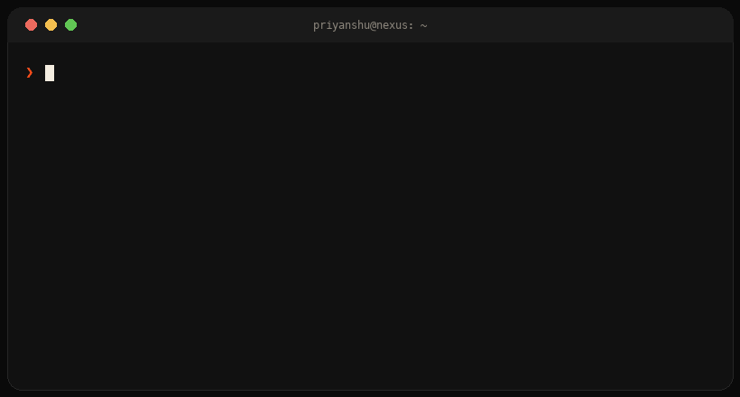

<h1>Hey, I'm Priyanshu Sekhar Nanda 👋</h1>

<b>Founder · Full-stack developer · Bengaluru</b> I build AI, IoT and realtime web products — and ship them.

  
  
  

---

### 🧑‍💻 About me

I'm a **founder and full-stack developer** in Bengaluru, finishing my **B.Tech in Computer Science** at GIET University. I like products that sit where software meets the real world: realtime web apps, IoT tracking, and AI that does one job well.

Right now I'm a **Software Developer at [R2E Technologies](https://rahi.r2e.in)**, where I build the **RAHI** IoT platform and the **AVNI** mentorship platform, and I'm shipping **NEXUS**, a workspace where chat turns into tasks and work gets assigned by rules your team can read.

- 🔭 **Building:** NEXUS · AVNI · RAHI
- 🌱 **Exploring:** RAG systems, Spring AI, realtime systems
- 🎤 **Off-screen:** startups, swimming, photography, public speaking
- 💬 **Ask me about:** shipping MVPs fast, IoT + web, hackathons

  

## 🚀 Featured work

<table>
<tr>
<td width="50%" valign="top">

### [AVNI](https://avni.app)
**One identity, infinite workspaces.** A multi-tenant platform for India's builders — founders, mentors, incubators and accelerators. Role-based access, session scheduling, peer review, realtime notifications and automated PDF/Excel reports.

`React` `Node.js` `Socket.IO` `MongoDB` · **+30% engagement**

</td>
<td width="50%" valign="top">

### [RAHI](https://rahi.r2e.in)
**Patented connected-intelligence platform.** An enterprise command center for multi-company operations: realtime GPS/IoT field-asset tracking, AI-driven insights and an HR toolkit. Backed by STPI, MSME and IIT Ropar / Tirupati.

`React` `Node.js` `Firebase` `Maps API` · **Patented · IIT-funded**

</td>
</tr>
<tr>
<td width="50%" valign="top">

### NEXUS · in progress
**Where conversations become finished work.** Chat, tasks and docs in one workspace. Any message becomes a task in one click; a rule engine picks the assignee and explains why. Realtime chat, drag-and-drop board, ⌘K palette.

`Next.js 16` `TypeScript` `Express` `Socket.IO` `MongoDB`

</td>
<td width="50%" valign="top">

### [Verolinkr](https://verolinkr.com)
**Get paid for proof, not promises.** A creator–brand collaboration platform: matching, campaign briefs, payments and analytics in one flow.

`Next.js` `TypeScript` `Firebase` `Razorpay`

</td>
</tr>
<tr>
<td width="50%" valign="top">

### [School Document Q&A](https://github.com/priyanshu18sekhar/school-document-qa-rag)
**RAG that cites its sources and refuses to guess.** A multi-tenant service that answers questions about school policy documents with page-level citations, and declines when it has no grounding.

`Java 25` `Spring Boot 4` `Spring AI 2` `pgvector`

</td>
<td width="50%" valign="top">

### Agri-Drone 🏆
**AI crop monitoring.** Drones and Raspberry Pi detect apple-plant disease at **98.9% accuracy**; follow-on carts check water and oxygen levels and spray pesticide, all run from an Android app. Won the IEI Drone Tech Hackathon.

`Python` `C++` `Raspberry Pi` `Android`

</td>
</tr>
</table>

## 🧭 Journey

| When | Role | Where |
|:--|:--|:--|
| **Apr 2025 — now** | Software Developer | **R2E Technologies**, Bengaluru — leading RAHI and AVNI: realtime GPS tracking, role-based access, automated reporting |
| **Jun — Jul 2025** | Research Fellow (summer) | **IIT Madras** — data-driven learning of dynamics for control in robotics and power systems |
| **Apr 2024 — Dec 2025** | Android Lead & Secretary | **Android & IoT Club, GIET University** — ran workshops for 700+ students, supervised drone and GPS hardware builds |

## 🏆 Recognition

- 🥇 **Winner** — IEI Drone Tech Hackathon (2024)
- 🥉 **Top 3** — Smart India Hackathon, national IoT + AI solution (2024)
- 📜 **Patent** — RAHI connected-intelligence platform
- 📄 **Paper** — *Intelligent Navigation Control through Vision-Based Hand-Gesture Recognition using YOLOv8n*
- 📄 **Paper** — *Impact of AI on Children Aged 5–9 and 9–15 through an HCI Lens* (BISS Conference)

## 🛠️ Toolkit

  <b>Languages</b> 
  

  <b>Frontend & mobile</b> 
  

  <b>Backend, data & tools</b> 
  

---

**Open to collaborations, freelance builds and interesting problems.** The fastest way to reach me is [email](mailto:priyanshusekharnanda@gmail.com) or [LinkedIn](https://www.linkedin.com/in/priyanshu-sekhar-nanda).

The room and the terminal are pixel-drawn for this profile · last tweaked Oct 2026

